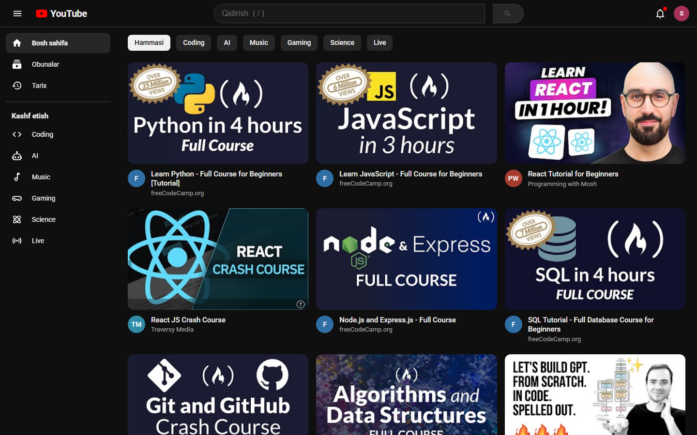
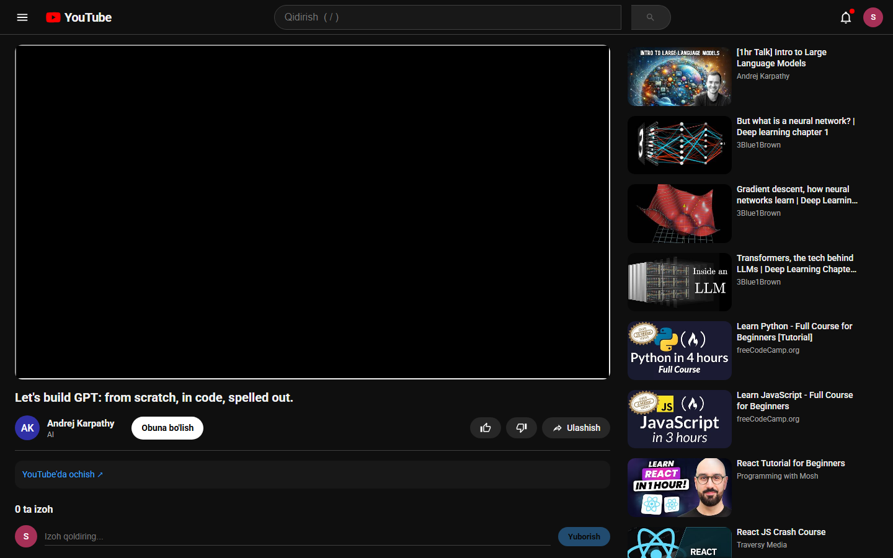

# YouTube Clone ▶️

**Live demo → https://xojiakbar3031.github.io/youtube-clone/**

A YouTube-style video app built with **React 18 + Vite**. It plays real videos through
the official embed player and has categories, search, a watch page with related
videos, likes, subscriptions, comments and watch history. The interface is in Uzbek.



## Features

- **Real videos without an API key.** The catalog is built by
  [`scripts/build-catalog.mjs`](scripts/build-catalog.mjs), which checks every video
  ID against YouTube's oEmbed endpoint. It gets the real title and channel and drops
  removed or private videos.
- **Optional live search.** If you set `VITE_YOUTUBE_API_KEY`, the app searches
  YouTube Data API v3 instead and shows view counts, durations and upload dates. On
  any API error it falls back to the local catalog.
- **Hash routing** (`#/watch/:id`, `#/?q=&c=`, `#/history`, `#/subscriptions`): the
  back button works, any view can be shared as a link, and it runs on GitHub Pages
  with no server config.
- **Watch page**: privacy-enhanced embed (`youtube-nocookie.com`), related videos
  from the same category first, like/dislike, subscribe, Web Share API with a
  clipboard fallback, and an expandable description.
- **User state in `localStorage`**: subscriptions feed, last 50 watched videos,
  comments (add and delete) and reactions.
- **Polish**: skeleton loading, the `/` shortcut to focus search, a sidebar drawer
  with backdrop on smaller screens, layouts from desktop down to phone, focus
  rings, and requests cancelled when the query changes.



## Run locally

```bash
npm install
npm run dev          # http://localhost:5173
npm run build        # production build in dist/
npm run catalog      # re-verify / rebuild src/data/catalog.json
```

To enable live search, copy `.env.example` to `.env.local` and set `VITE_YOUTUBE_API_KEY`.

## Structure

```
src/
  App.jsx                 routes → views
  components/             Header, Sidebar, VideoGrid (+ chips, skeletons), WatchView (+ comments), Avatar
  lib/videos.js           data source: local catalog or YouTube Data API
  lib/store.js            subscriptions, reactions, comments, history (localStorage)
  lib/useHashRoute.js     tiny hash router
  data/catalog.json       generated by scripts/build-catalog.mjs
```

## License

MIT. Videos and thumbnails belong to their creators and are shown through YouTube's
official embed.
